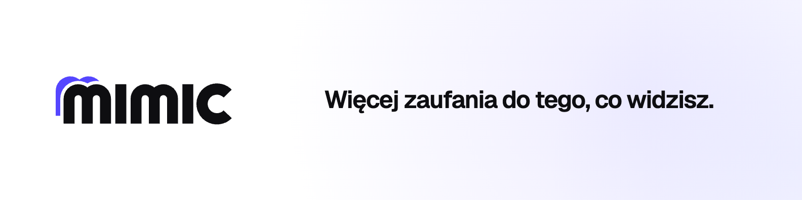

<p align="center">
  
</p>

# Mimic

Narzędzie do zadania NASK "Follow the Fake" (HackNation 2026). Z pojedynczych podejrzanych reklam i stron wydobywa wspólne ślady i łączy je w kampanie. Każde połączenie ma listę przesłanek, więc widać, dlaczego dwa materiały uznano za część jednej kampanii. Nowy materiał jest przypisywany do istniejącej kampanii albo oznaczany jako "nowy wzorzec".

## Co robi

- **Wczytuje** zapisane strony (HTML, MHTML), logi HAR, zrzuty ekranu, nagrania i adresy URL.
- **Wyciąga ślady** w pięciu grupach: tekst, obraz, infrastruktura (trackery, domeny, RDAP, DNS, certyfikaty), szablon strony i osoby (nazwiska oraz twarze).
- **Porównuje** materiały ważonym podobieństwem. Brak danych nigdy nie obniża wyniku.
- **Grupuje** w kampanie tylko z uzasadnieniem: twardy ślad, dowody z dwóch niezależnych źródeł albo jedna bardzo silna przesłanka.
- **Pokazuje**, po czym można dzielić na kampanie: sześć kryteriów (operator, szablon, narracja, wizerunek, platforma, łączone) i graf powiązań z opisem każdej krawędzi.
- **Przypisuje** nowy materiał do kampanii albo mówi "nowy wzorzec", zamiast dopasowywać na siłę.

## Uruchomienie

Wymagane: Python 3.12 i [uv](https://docs.astral.sh/uv/).

```bash
make setup
```

```bash
make run
```

Aplikacja Streamlit działa pod adresem http://localhost:8501.

Główny interfejs (React) działa z API. W trybie deweloperskim uruchom serwer przez `make api` (port 8000), a w drugim terminalu `cd web && npm ci && npm run dev` (port 5173). W Dockerze FastAPI podaje też zbudowaną aplikację:

```bash
docker compose up --build web
```

Interfejs jest wtedy pod adresem http://localhost:8000.

Docker (bez instalowania Pythona):

```bash
docker compose up --build
```

Dane organizatora nie są w repozytorium. Jak je umieścić: [data/README.md](data/README.md). Bez danych aplikacja się uruchamia, a materiały można wgrywać w interfejsie.

## Polecenia

| Polecenie | Działanie |
|---|---|
| `make setup` | instalacja zależności z `uv.lock` |
| `make run` | uruchomienie aplikacji Streamlit |
| `make api` | serwer API (FastAPI) na porcie 8000 |
| `make web` | serwer deweloperski interfejsu React na porcie 5173 |
| `make web-build` | budowa interfejsu React do `web/dist` |
| `make ingest` | odkrycie materiałów w `data/raw/`, policzenie cech, zapis w bazie SQLite |
| `make eval` | ocena grupowania na etykietach z `data/labels/` (precyzja, pokrycie, ARI, test "nie łącz") |
| `make refresh` | wyszukanie reklam w bibliotece reklam Meta (wymaga tokenu), dopisanie do bazy i przypisanie do kampanii |
| `make labels-check` | sprawdzenie, że etykiety odpowiadają materiałom na dysku |
| `make test` | testy |

## Konfiguracja

Zmienne środowiskowe (wzór w `.env.example`, plik `.env` nie trafia do gita):

| Zmienna | Znaczenie | Domyślnie |
|---|---|---|
| `MIMIC_RAW_DIR` | katalog z materiałami | `data/raw` |
| `MIMIC_CACHE_DIR` | cache cech i wzbogacenia | `data/cache` |
| `MIMIC_DB_PATH` | baza SQLite | `data/cache/mimic.sqlite` |
| `MIMIC_LABELS` | plik etykiet do oceny | `data/labels/labels.json` |
| `MIMIC_ENRICH` | `1` włącza zapytania o metadane domen (RDAP, DNS, crt.sh) | `0` |
| `MIMIC_ALLOW_FETCH` | `1` pozwala pobrać stronę spod podanego URL (statycznie, bez JS) | `0` |
| `META_AD_LIBRARY_TOKEN` | token dostępu do biblioteki reklam Meta (bez niego odświeżanie zgłasza brak) | puste |
| `MIMIC_ADLIB_QUERIES` | frazy wyszukiwania oddzielone przecinkami, np. `inwestycje,suplement` | puste |
| `MIMIC_ADLIB_COUNTRIES` | kraje docelowe reklam | `PL` |
| `MIMIC_REFRESH_SECONDS` | odstęp między odświeżeniami w trybie ciągłym | `21600` |
| `MIMIC_EXTRAS` | dodatkowe grupy zależności w obrazie Docker, np. `video,faces` | puste |
| `MIMIC_MODELS_DIR` | katalog modeli | `models` |
| `MIMIC_FACE_REFS` | katalog z obrazami referencyjnymi osób (`<imię nazwisko>/zdjęcie.jpg`) | `data/refs/images` |
| `MIMIC_FACE_THRESHOLD` | próg podobieństwa twarzy | `0.5` |

## Okresowe odświeżanie z biblioteki reklam

```bash
docker compose --profile refresh up -d refresher
```

Usługa co `MIMIC_REFRESH_SECONDS` pobiera reklamy dla zapytań z `MIMIC_ADLIB_QUERIES`, wylicza cechy, przypisuje nowe reklamy do istniejących kampanii albo oznacza je jako nowy wzorzec i zapisuje wynik w bazie. Pobierane są tylko metadane reklam (tekst, strona reklamodawcy, domena docelowa), nigdy strony oszustów.

## Rozpoznawanie twarzy (tylko lokalnie)

Porównywanie twarzy jest opcjonalne (dodatek `faces`). Cecha `person.face_vectors` łączy materiały z tą samą twarzą bez żadnej bazy zdjęć. Nazwanie osoby (`person.faces`) działa wyłącznie na lokalnych zdjęciach referencyjnych. Zdjęcia osób nie trafiają do repozytorium ani do obrazu Dockera. Bez zdjęć cecha `person.faces` jest jawnym brakiem, a osoby są rozpoznawane po nazwiskach w tekście i OCR. Bez dodatku `faces` obie cechy są jawnym brakiem.

1. Zainstaluj zależność: `uv sync --extra faces` (w Dockerze: `MIMIC_EXTRAS=faces`).
2. Pobierz model rozpoznawania twarzy (ok. 300 MB, trafia do `models/`, poza gitem): `uv run python scripts/fetch_models.py`.
3. Dodaj zdjęcia wybranych osób w `data/refs/images/<imię nazwisko>/` (3 do 5 zdjęć na osobę, jedna osoba na zdjęciu, twarz wyraźnie widoczna, JPG lub PNG). Nazwa folderu powinna zgadzać się z nazwą w `data/refs/persons.json`.
4. Uruchom `make ingest` albo aplikację. Cechy są liczone od nowa, gdy zmieni się zawartość folderu.

Próg podobieństwa: `MIMIC_FACE_THRESHOLD` (domyślnie 0.5).

## Obsługiwane materiały i ograniczenia

Obsługiwane: strony HTML i MHTML wraz z katalogami zasobów, logi HAR, zrzuty ekranu (PNG, JPG, WEBP, GIF, BMP), nagrania (MP4, MOV, WEBM, MKV, M4V), pliki `info.json` i `manifest.json`, adresy URL, archiwa ZIP z tymi plikami. Wgrywany materiał może mieć dowolną kombinację tych rodzajów.

Nie jesteśmy przygotowani na:
- strony wymagające wykonania JavaScriptu do wyświetlenia treści (nie wykonujemy skryptów oszustów, analizujemy tylko zapisane pliki)
- PDF, dokumenty Office i zrzuty w formie samych zdjęć bez tekstu, gdy OCR nie jest zainstalowany (OCR i wideo wymagają zależności `ocr` i `video`)
- format ZIP z ponad 2000 plików lub ponad 512 MB po rozpakowaniu
- strony pobierane spod adresu na żywo, jeśli `MIMIC_ALLOW_FETCH` nie jest włączone (domyślnie analizujemy tylko samą domenę)
- twarze: dopasowanie po twarzy działa tylko z dodatkiem `faces` i lokalną bazą obrazów w `data/refs/images/<imię nazwisko>/` (poza repozytorium). Bez nich osoby są rozpoznawane po nazwiskach w tekście i OCR, a `person.faces` jest jawnym brakiem

Brak któregokolwiek pliku nie przerywa analizy: brakująca cecha jest oznaczona jawnie i nie obniża podobieństwa.

## Bezpieczeństwo

Materiały to oszukańcze strony. Nie otwieraj ich w przeglądarce. Narzędzie parsuje je jako statyczne pliki (HTML, HAR, obrazy) i nie wykonuje ich skryptów. Zapytania sieciowe dotyczą wyłącznie publicznych metadanych domen i są domyślnie wyłączone.

## Struktura

- `web/` interfejs React (główna scena demo)
- `api/` API (FastAPI) nad silnikiem
- `app/` zapasowy demonstrator (Streamlit)
- `engine/` logika bez zależności od interfejsu: `ingest`, `features`, `similarity`, `cluster`, `store`, `explain`, `enrich`
- `eval/` metryki i ocena
- `brand/` identyfikacja wizualna: logo, banery, film demo
- `data/labels/` etykiety kampanii (jedyna część `data/` w gicie)
- `docs/` metodyka, źródła danych, decyzje

## Dokumentacja

- [Metodyka](docs/methodology.md): cechy, podobieństwo, grupowanie
- [Źródła danych i licencje](docs/data-sources.md)
- [Decyzje projektowe](docs/decisions.md)
